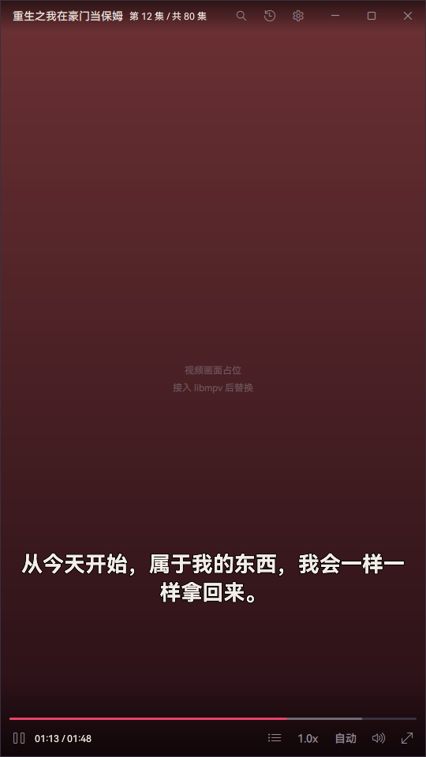
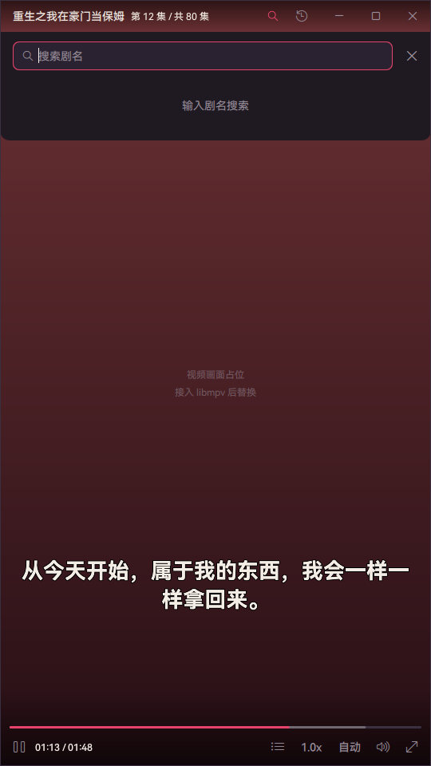
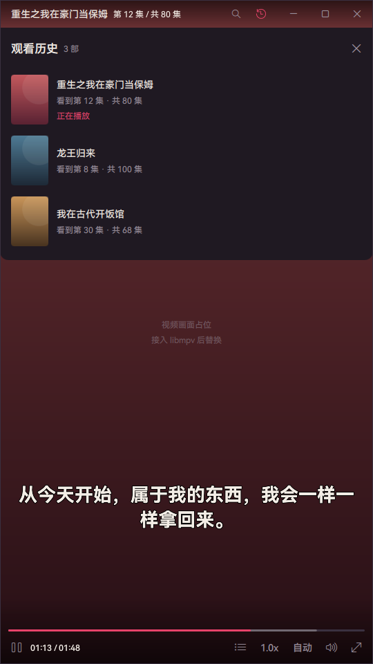
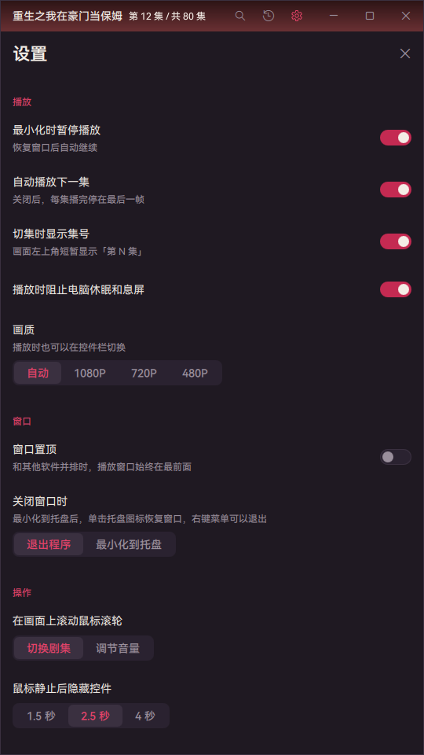

# IHaveApple 沉浸式短剧播放器 · Windows UI 原型（Qt 6 / QML）

按 [`docs/windows-ui-design.md`](../docs/windows-ui-design.md) v2.0 实现的**可交互 UI 原型**。整个应用只有一个播放界面：选集通过控件栏的「选集」按钮打开，搜索、观看历史和设置通过标题栏右侧的三个按钮打开。
**窗口就是视频**：窗口锁定 9:16，画面铺满、不留边；标题栏和控件叠加在画面上，鼠标静止 2.5 秒后一起隐藏。
视频画面是占位（渐变 + 模拟字幕）。接入 libmpv 后，只需要替换 `qml/VideoSurface.qml`。

| 播放 | 选集面板 |
|---|---|
|  |  |

| 搜索 | 观看历史 |
|---|---|
|  |  |

| 设置 |
|---|
|  |

| 暂停（中央播放按钮） | 窗口适配视频比例 |
|---|---|
|  |  |

| 频道 tab + 底部信息区 |
|---|
|  |

## 运行

需要 Python 3.10+、PySide6 6.6+（用到了 `font.features`）和 **ffmpeg**（在 PATH 里）。

ffmpeg 用于封面转码：服务端返回的海报是 HEIC（Qt 和 Pillow 都解不了），由 `hgservice.py`
在后台转成本地 JPEG，缓存在 `.cache/covers/<剧id>.jpg`。找不到 ffmpeg 时界面退回渐变占位，
其它功能不受影响。转码按 2 路低优先级进行，避免和 libmpv 的软渲染抢 CPU 导致播放掉帧。

```bash
pip install PySide6
python main.py               # 首屏播本次推荐（每次启动换一部）
python main.py --drama 3     # 指定播放第 3 部
```

| 参数 | 说明 |
|---|---|
| `--drama` | 要播放的剧。留空（默认）＝ 首屏用推荐；也支持 1–9 的序号、完整剧 id（19 位字符串） |
| `--page` | 演示状态：`player`（默认）`episodes` `search` `history` `settings` `end` `error` `offline` `immersive` |
| `--size 540x960` | 指定初始窗口尺寸（调试用，非 9:16 时画面两侧会留黑）；不传则按 9:16 自动确定 |
| `--shot out.png` | 22 秒后截图并退出 |
| `--reduced-motion` | 强制按"减少动画"模式运行（默认读取 Windows 系统设置） |

### 频道

顶部有四个透明的频道 tab：**真人剧 · 漫剧 · AI剧 · 推荐**（与红果一致，选中项为字幕白 + 海棠红下划线）。

- tab 不加任何背景块，文字直接压在画面上；和标题栏一样跟随控件淡入淡出，鼠标静止后一起隐藏，不破坏沉浸。
- 切换 tab 会换掉整个内容流（`/v1/feed?channel=`），并播该频道的推荐；选中的频道持久保存，下次启动直接进入。
- **AI剧 目前是空的**：上游对这个频道返回 `502 unknown discover channel`，所以界面显示「「AI剧」暂时没有内容」。
  这个频道名一旦上游放开就会自动出现内容，代码不用改。

**切换是秒开的**。`/v1/feed` 每次回源要 4–5 秒（后端不缓存），是全链路最慢的一环，所以 feed 结果按频道缓存到
`.cache/feeds/<频道>.json`（同时有内存副本）：

| 场景 | 优化前 | 现在 |
|---|---|---|
| 切回访问过的频道 | 4.5–7.5s | **0–0.6s** |
| 冷启动后的第一次切频道（预热已完成） | 4.5s | **0.9s** |
| 无内容频道（AI剧）切过去 | 8.8s | **1.1s** |
| 重启应用后切任意频道 | 4.8s | **0s**（读磁盘缓存，立即出画面） |
| 冷启动首屏（完全没缓存） | 4.8s | 4.9s（省不掉，但只发生一次） |

两个细节：切回频道会**回到上次在这个频道看的那部**（不是从头随机）；首屏拿到剧单后会**并行预热其余频道**，
所以第一次切也能命中缓存。后台刷新只更新缓存文件，不打断正在播放的内容。

### 首屏推荐

`/v1/feed` 是抖音式推荐流，一页 9 部。原型把这些当作推荐池：

- 启动时从池里随机挑一部播放，**每次启动都不同**（`QSettings` 记住上次推荐的那部并排除，不会连续重复）。
- 剧单不再为「拿集数」逐部预拉分集：`feed` 自带 `episode_count`，分集只在真正要播那部时才拉，
  所以启动只花一次 `feed` 请求（~3 秒），比之前「4 部 × 每部拉分集」快。
- 封面同理，启动只转首屏那几张，打开搜索 / 历史面板时再补齐剩下的。
- 想看固定某部用 `--drama <序号或 id>`；这时不会被推荐覆盖。

`Ctrl+Shift+D` 打开状态演示面板，可以切换首帧慢、缓冲、播放失败、编码降级、全剧终、断网和减少动画（正式版删除）。

`tools/verify_search.py` 验收搜索链路（封面、点击切剧、多集数选集分页）：

```bash
python -I tools/verify_search.py      # 输出 PASS/FAIL，退出码 0 表示全通过
```

`tools/verify_ui_actions.py` 验收暂停时的中央播放按钮与「窗口适配视频比例」按钮：

```bash
python -I tools/verify_ui_actions.py  # 同样输出 PASS/FAIL
```

`tools/verify_recommend.py` / `tools/verify_feed_ui.py` 验收首屏推荐（多次启动换剧、界面里只起播推荐那一部）：

```bash
python -I tools/verify_recommend.py   # 推荐轮换（纯后端，连跑 8 次）
python -I tools/verify_feed_ui.py     # 完整界面里首屏是否就是推荐
```

`tools/verify_feed_scroll.py` 验收信息流语义（滚动换剧、底部信息区、进入查看全剧、自动连播同剧）：

```bash
python -I tools/verify_feed_scroll.py
```

`tools/verify_search_page.py` 验收整版搜索页（铺满窗口、打开时暂停、封面加载）：

```bash
python -I tools/verify_search_page.py
```

`tools/verify_prefetch.py` 验收下一集预取（起播预取、临近结尾兜底、去重、切集收益）：

```bash
python -I tools/verify_prefetch.py
```

`tools/verify_channels.py` 验收顶部频道 tab（四枚、默认推荐、切换换流、AI剧 空状态、缓存秒开）：

```bash
python -I tools/verify_channels.py
```

`tools/probe_channel_cache.py` 单独量化缓存效果（冷/热启动、各频道切换耗时）：

```bash
python -I tools/probe_channel_cache.py           # 清缓存，测冷启动
python -I tools/probe_channel_cache.py --keep     # 保留缓存，测热启动
```

`tools/verify_interactions.py` 会模拟按键和点击，在切集动画中途、字幕卡、选集方格联动、倍速菜单、窄窗口等时刻截图，用于自查：

```bash
python -I tools/verify_interactions.py . out_dir
```

## 快捷键

默认：`空格` 播放暂停 · `←` `→` 快退快进 5 秒 · `↑` `↓` 上一部 / 下一部短剧（与滚轮同义）· `E` 选集 · `F` 或双击舞台 沉浸模式 ·
`M` 静音 · `[` `]` 倍速 · `Ctrl+F` 搜索 · `H` 观看历史 · `Ctrl+,` 设置 · `Esc` 逐层关闭（菜单 → 设置 / 搜索 / 历史 → 选集面板 → 沉浸模式）

除 `Esc` 外都可以在设置页修改。

## 信息流语义

上下滚动（和 `↑` `↓`）**换的是短剧，不是剧集**——像刷推荐流一样一部一部过：

- 换剧后从该剧第 1 集开始（有观看进度则接着上次），滚到剧单末尾会回到第一部。
- 集内的前进只有两条路：**等本集播完自动连播下一集**（同剧，不换剧），或点底部信息区的**「进入查看全剧」**跳集。
- 底部信息区常驻显示：剧名（最多 2 行）、简介（最多 2 行）、「第 N 集 / 共 M 集」、「进入查看全剧 ›」。
  剧名和简介是从标题栏搬下来的——标题栏一行放不下长剧名，底部通栏能完整显示。

## 搜索与观看历史

两者共用一个**整版页面**：从标题栏下方铺到窗口底部（占窗口 92% 高度），列表占满剩余空间，一次能看到更多结果。
整页会盖住画面，所以打开时**暂停播放**，关闭后恢复（用户原本就暂停的保持暂停）。

封面加载做过几轮优化：

- **批量取地址**：搜索结果本身不带封面地址，用 `/v1/series-batch?ids=...` 一次问完（逐部查是 N 次往返）。
- **优先用 JPEG**：`episodes[0].cover_url` 是 JPEG，`series.cover_url` 是 HEIC。用前者能省掉 ffmpeg 的 HEVC 解码，
  单张从约 0.5s 降到 0.1s。
- **4 路并发**（每路单线程、低优先级），实测不影响播放帧率。
- **搜索结果优先出图**：频道剧单的封面排在后面，因为用户正在看的是搜索列表。

实测（6 条结果）：搜索本身 2.2s，封面全部就绪 3.8s —— 改动前 4.5s。
其中约 1.7s 是后端 `series-batch` 逐部回源的硬成本。

## 下一集预取

服务端把一集落到本地要 **3–8 秒、约 6MB**，落盘后切集是秒开（`/v1/stream` 直接读本地 mp4），
没落盘就要实时转封装（1–2 秒首帧）。所以：

- 本集**已播 ≥ 8 秒**且**剩余 ≤ 20 秒**（`Store.prefs.prefetchLead`）时，预取下一集（解析地址 + `/v1/cache/prewarm/`）。
- 快速滑动换集时不触发，避免连续落盘把缓存和带宽打满。
- 同一集去重；失败清标记可重试；本剧最后一集不预取；预取失败不影响播放。

> ⚠️ 2026-11-21 事故（**我最初判断错了，此处为更正后的结论**）：
> 当天播放全挂，报 `anonymous response was empty`。当时以为是 prewarm 烧光了匿名额度，
> 把预取降级成"只解析地址"。**真实原因与 prewarm 无关**：`/v1/play` 一直正常，
> 失败的是 `/v1/stream` —— 本机 ffmpeg 拉上游 CDN 报 `Peer certificate failed verification`
> → 返回 0 字节。ohgd 是纯 Windows 进程，ffmpeg(OpenSSL) 找不到 CA 库；
> 在 MSYS/pwsh 手动执行同样的命令却成功，所以被"手动能播、应用不能播"误导。
> 修复：`hgd/main.go` 的 ffmpeg 参数加 `-tls_verify 0` 后重新编译。
> 教训：`/v1/play` 成功 ≠ 能播，必须用 `/v1/stream` 的实际字节数验证。

## 搜索与观看历史

两者共用一个**整版页面**：从标题栏下方铺到窗口底部（占窗口 92% 高度），列表占满剩余空间，一次能看到更多结果。
整页会盖住画面，所以打开时**暂停播放**，关闭后恢复（用户原本就暂停的保持暂停）。

封面加载做过几轮优化：

- **批量取地址**：搜索结果本身不带封面地址，用 `/v1/series-batch?ids=...` 一次问完（逐部查是 N 次往返）。
- **优先用 JPEG**：`episodes[0].cover_url` 是 JPEG，`series.cover_url` 是 HEIC。用前者能省掉 ffmpeg 的 HEVC 解码，
  单张从约 0.5s 降到 0.1s。
- **4 路并发**（每路单线程、低优先级），实测不影响播放帧率。
- **搜索结果优先出图**：频道剧单的封面排在后面，因为用户正在看的是搜索列表。

实测（6 条结果）：搜索本身 2.2s，封面全部就绪 3.8s —— 改动前 4.5s。
其中约 1.7s 是后端 `series-batch` 逐部回源的硬成本。

## 下一集预取

**只解析地址，绝不预下载。** 解析一集地址约 400ms，而 `/v1/cache/prewarm/` 会让服务端落盘整集（约 6MB）。

> ⚠️ 2026-11-21 事故：预取曾经改成"起播即 prewarm"，在专辑界面连续滚过几十集，每集落盘 6MB，
> 缓存涨到 2.0GB 后**上游匿名额度耗尽**（HTTP 200 + 空 body，`anonymous response was empty`），
> 当天所有未缓存的集都播不了。此后 prewarm 被列为禁止项。

现在的做法：

- 本集**已播 ≥ 8 秒**且**剩余 ≤ 20 秒**（`Store.prefs.prefetchLead`）时，解析下一集地址。
- 快速滑动换集时不触发（看不懂这条就会重演事故）。
- 同一集去重；失败清标记可重试；额度类错误保留标记，不再反复撞上游。
- 额度耗尽时立即失败并提示「上游暂时限制了匿名访问，换一部已缓存的剧或稍后再试」，
  不会卡在转圈（`_api` 对额度类错误不重试）。

